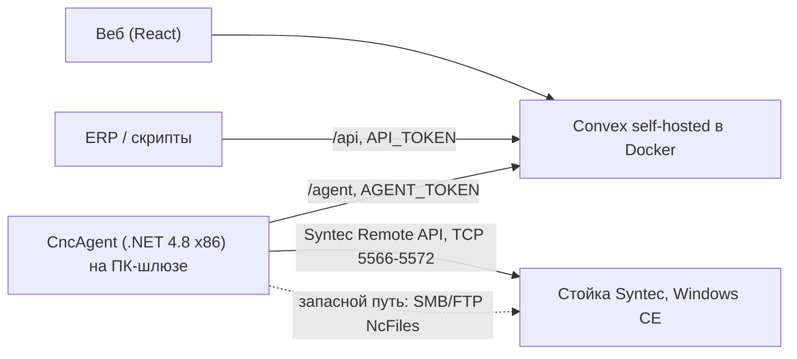
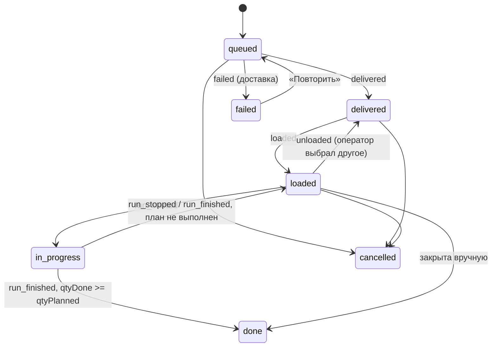

# Handoff: cnc-erp

Документ для того, кто продолжит работу (человек или агент). Здесь всё, что не видно из кода: требования, принятые решения и почему, что проверено, что нет, как устроен стенд и что делать дальше. Пошаговое внедрение — `ВНЕДРЕНИЕ.md`, HTTP-контракт — `API.md`.

Состояние на 9 ноября 2026: код готов, сквозной прогон пройден на эмуляторе (fake), с настоящим протоколом Syntec на симуляторе 10.118 пройдены подключение, чтение, доставка, выбор основной программы, тревоги и реакция на ручной выбор оператора. Старт, M30 и счётчик деталей проверяются только на станке. Git-репозитория нет, ничего не закоммичено.

## 1. Задача и требования пользователя

- Подпроект рядом с `laser-erp` (лазер на Windows 10), «практически такая же» задача: получать информацию со станка и ставить ему задачи. Станок — фрезер Velber M2130ATC-R12, стойка Syntec 60W-E на Windows CE, ПО 10.118.14H. Программы — `.cnc` из `chpu-driver/БРЕНД АРДЕКО/860` и `/960`.
- Нужны реализация, проверка на виртуалках на компьютере пользователя и гайд по развёртыванию на станке.
- Дилера нет — только свои решения и то, что можно найти самим.
- «Станки не должны выходить в интернет, только в локальной сети живут, чтобы не обновлялись».
- На стойку (Windows CE) ничего не ставим.

Правила работы с пользователем (соблюдать):

- Отвечать по-русски.
- Не трогать `leanpro`.
- Не коммитить без прямой просьбы. Коммиты — conventional commits (`feat`, `fix`, `chore`, `docs`, `refactor`, `test`), задачи GitLab — `#<номер>`; если запрос про «меня/мои» в GitLab — сначала спросить имя пользователя GitLab.
- Не создавать лишних `.md` (этот и `ВНЕДРЕНИЕ.md` созданы по прямой просьбе).
- Convex: у каждой функции валидаторы `args` и `returns`. TypeScript без `any`.
- Скрипты PowerShell 5 с кириллицей сохранять в UTF-8 с BOM, иначе кириллица ломается.

## 2. Архитектура



| Часть | Где | Что |
|---|---|---|
| Сервер | `server/`, `Запустить-сервер.cmd`, `server/start.sh` | Docker: `convex-backend`, `convex-dashboard`, веб (`serve` собранного Vite), контейнер `firewall` для iptables на Linux. Порты 3220 (Convex), 3221 (HTTP actions), 5174 (веб), 6792 (панель) |
| Бэкенд | `convex/` | схема, очередь, события агента, внешнее API |
| Веб | `src/App.tsx` | страницы «Очередь» (задачи + полоса станков), «Программы» (загрузка, превью), «Станки» (карточки с состоянием, журналом, debug-логом агента), страница задачи |
| Разбор G-кода | `convex/lib/parseGcode.ts` | строки, инструменты, обороты, длина реза и холостых, врезки, габарит, оценка времени, превью; номенклатура из имени файла. Проверка: `npm run check-parse -- "../chpu-driver/БРЕНД АРДЕКО"` |
| Агент | `agent/CncAgent` | цикл опроса, доставка, выбор основной, учёт прогонов, тревоги, outbox |
| Установщик | `agent/installer`, `agent/build-usb.ps1` | флешка: `Установить.cmd`, `Проверить-стойку.cmd`, `Проверить-передачу.cmd`, `Настроить-сеть.cmd`, `Удалить.cmd`, `ИНСТРУКЦИЯ.txt` |
| Библиотеки Syntec | `agent/syntec-libs.ps1` → `agent/lib/syntec` (v4) и `agent/lib/syntec-10.118` | проприетарные, в git не идут (`.gitignore`), скачиваются и сверяются по SHA-256 |
| Утилита | `agent/SyntecProbe` | ручная проверка Remote API (подключение, чтение, вызовы) |
| Сквозной тест | `agent/e2e-fake.ps1` | сервер + агент с `Link=fake`: доставка, стоп, 2 детали, тревога |

## 3. Принятые решения и почему

| Решение | Почему | Что отвергли |
|---|---|---|
| Агент на отдельном ПК-шлюзе, стойку не трогаем | на Windows CE со закрытой оболочкой Syntec ставить своё рискованно, а помочь без дилера некому | агент на самой стойке |
| Связь со стойкой — Syntec Remote API | единственный путь получить состояние (режим, строка, счётчик, тревоги) и выбрать основную программу; сервер встроен в прошивку («Core server») | только FTP/сетевая папка — нет обратной связи |
| FTP/сетевая папка оставлены как запасные каналы (`folder`, `ftp`, `RemoteDir` у `syntec`) | если Core server нет или он не принимает файлы, доставка всё равно работает | — |
| Агент на .NET Framework 4.8 x86 (у лазера .NET 8) | библиотеки Syntec — 32-битные сборки .NET Framework с нативными DLL | .NET 8 |
| Две библиотеки Syntec, выбор во время работы (`SyntecLib`: `auto` / `10.118` / `v4`) | v4 (Syntec.RemoteCNC 1.0.12, GitHub) читает 10.118, но файлы не передаёт: `FileUploadErrorCode -16` = `SocketError`. Клиент 10.118.52.15 (Syntec.OpenCNC из архива симулятора) передаёт | только v4 |
| Каждая библиотека в своей подпапке, нативные DLL предзагружаются по полному пути (`LoadLibraryEx` с `LOAD_WITH_ALTERED_SEARCH_PATH`), класс создаётся через `Activator`, вызовы через `dynamic` | у обеих сборок нативные DLL с одинаковыми именами (OCAPI/OCApi, OCKrnl), в одной папке они конфликтуют; сигнатуры нужных методов у сборок совпадают | ссылка на сборку при компиляции |
| «Старт» нажимает только оператор, агент не пишет в ПЛК | безопасность: заготовка, инструмент и ноль проверяет человек | автостарт через PLC-биты (методы `WRITE_plc_*` в клиенте есть) |
| Не перезаписывать программу, которая выполняется; не менять основную во время работы | нельзя ломать идущую обработку | — |
| Если оператор выбрал другую программу — событие `unloaded`, задача в `SkipAuto`, агент её больше сам не выбирает | не воевать с оператором | — |
| Деталь засчитывается по росту счётчика стойки (M30), запасной признак — программа дошла до `lines − 3` | счётчик может быть не настроен | только по счётчику |
| События с `eventId` (GUID) + outbox на диске (`outbox.json`), сервер отбрасывает повторы (`agentEvents.by_event`) | обрывы сети и перезапуски агента не теряют и не удваивают события | — |
| Состояние агента в `state.json` (доставленные, загруженная задача, текущий прогон, тревоги) | прогон, начатый до перезапуска агента, закрывается правильно | — |
| Пульс раз в `2 × PollSec` (минимум 2 с), список файлов раз в 60 с; `online` = пульс за 30 с | нагрузка на стойку и сервер | — |
| Доставка заранее до `DeliverAhead` (3) задач | оператор не ждёт файл между задачами | — |
| Имя на стойке `cncName`: латиница, цифры, `_`, `-`, до 60 символов, расширение до 4 | Windows CE и стойка плохо относятся к кириллице и длинным именам | — |
| Сервер — тот же стек, что у `laser-erp` (Convex self-hosted + Vite), другие порты | один сервер в цеху может держать оба проекта | — |
| Сеть станков без шлюза и DNS, адреса статические (192.168.50.0/24) | требование «не выходить в интернет и не обновляться» | — |
| Задача агента в планировщике от SYSTEM при старте компьютера, перезапуск каждую минуту | работает без входа в Windows, переживает сбои | служба Windows (сложнее ставить и обновлять с флешки) |
| Внешнее API (`/api`) — отдельный ключ, CORS открыт | ERP и скрипты; в пределах локальной сети | — |

## 4. Модель данных и статусы

Таблицы (`convex/schema.ts`): `programs` (файл в хранилище, sha256, stats, номенклатура, `archived` для старых версий), `jobs`, `runs` (прогоны: finished/stopped, источник agent/operator), `counters` (номера `Ч-N`), `agentEvents` (дедупликация), `machineEvents` (журнал станка), `heartbeats` (последнее состояние каждого станка).



Задача без `machineId` достаётся первому агенту, приславшему по ней событие. Логика переходов — `convex/agent.ts` (`applyToJob`) и `convex/lib/runs.ts` (`recordRun`).

## 5. Агент: цикл и инварианты

`Agent.Tick()` каждые `PollSec` (2 с):

1. `Read()` со стойки → снимок (`CncSnapshot`).
2. `TrackLink`: `link_lost` после 3 неудачных чтений подряд, `link_restored` при восстановлении.
3. `PollServer`: задачи станка и неназначенные + до 10 недавно отменённых; чистка локального состояния.
4. `Deliver`: `queued` по времени создания, не больше `DeliverAhead` в ожидании; не трогать файл, который сейчас режется (повтор через 30 с); сетевые ошибки — повтор через 20 с, отказ стойки — `failed` и повтор через 5 мин.
5. `TrackRun`: `run_started` при `Running` с нашей программой; по окончании `run_finished` (счётчик вырос или дошли до конца) или `run_stopped`.
6. `SelectMain`: только когда стойка не режет; уже основная — `loaded`; иначе `WRITE_nc_main` не чаще раза в 15 с.
7. `TrackAlarms`: `alarm` / `alarm_cleared` по изменению набора тревог (аварийный стоп добавляется как «аварийный стоп»).
8. `state.json`, пульс, отправка outbox (по 50 событий).

Каналы (`ICncLink`): `SyntecRemoteLink`, `FakeCncLink` (эмулятор: команды `start/hold/resume/stop/alarm <текст>/clear/emg/mode <M>` в `fake-control.txt`), `FileDropLink` (`folder`/`ftp`, без чтения состояния).

Режимы `CncAgent.exe`: без аргументов — работа; `--check` — разовая проверка стойки; `--upload <файл>` — разовая передача файла тем же путём, что в работе (основную не меняет).

Настройки (`Config.cs`, `cnc-agent.json`): `BaseUrl`, `Token`, `MachineId`, `Link`, `CncIp`, `CncTimeoutMs`, `SyntecLib`, `PollSec`, `AutoSelectMain`, `DeliverAhead`, `RemoteDir`, `FtpUser`, `FtpPassword`, `FakeDir`, `FakeAutoStartSec`, `FakeLinesPerSec`.

## 6. Что известно про Syntec Remote API

- Класс `Syntec.Remote.SyntecRemoteCNC(host, timeoutMs)`; подключение асинхронное, агент ждёт `isConnected()` до 15 с.
- Используемые методы: `READ_status(main, cur, seq, mode, status, alarm, emg)`, `READ_nc_pointer`, `READ_part_count`, `READ_spindle`, `READ_alm_current`, `READ_position`, `READ_information`, `READ_nc_mem_list`, `READ_nc_freespace`, `UPLOAD_nc_mem` + `isFileUploadDone` / `FileUploadErrorCode`, `WRITE_nc_main`, `Close`.
- Пустые строковые поля стойка отдаёт как `****` — агент превращает их в `null` (`Clean`).
- `UPLOAD_nc_mem` асинхронный: файл уходит во временную папку стойки (`\DiskC\ServerTmp`), стойка ставит его в `NcFiles`. Успех проверяется по списку программ.
- `READ_nc_mem_list` — строки `[имя, …, …, тип]`, берутся `тип == "FILE"`.
- `WRITE_nc_main` работает в AUTO и покое.
- Коды ошибок — `enum SyntecError` в `SyntecRemoteLink.cs`. Важные: `-16 SocketError` (обрыв, в т.ч. v4 на 10.118), `-1 CNCBusy`, `12 ErrorCNCMode`, `20 ErrorNeedUpdateVersion`. Отказ установки файла на стороне стойки — `TModifyError` (Fail = 1, AccessDeny = 5).
- Клиент 10.118: `Syntec.OpenCNC.dll`, `OCApi.dll`, `OCKrnl.dll`, `OCKrnlDrv.dll`, `SyntecFS.dll`, `Modbus.dll` (минимальный набор найден перебором). Нужен VC++ 2005 SP1 x86 (VC80 CRT). Файлы не подписаны, взяты из архива симулятора `CNC520.zip` (CNC Monitor v10.118.520, тема на 52pojie.cn через lanzou); Defender чист; хеши — в `syntec-libs.ps1`.
- Клиент v4: репозиторий [JMatveichik/Syntec.TestApp](https://github.com/JMatveichik/Syntec.TestApp), папка `Syntec/`; размеры совпадают с официальным комплектом `SyntecRemoteAPI_v4`.
- В клиенте есть `READ/WRITE_plc_*`, `WRITE_macro_*`, `WRITE_offset_*`, `WRITE_param_single` и др. Команды «Cycle Start» нет. Агент ничего из записи, кроме `UPLOAD_nc_mem` и `WRITE_nc_main`, не использует.
- Совместимость клиента 10.118.52.15 с прошивкой станка 10.118.14H не проверена (тот же major, на симуляторе 10.118.520 работает). Если стойка ответит `ErrorNeedUpdateVersion` или `VersionMismach` — пробовать `"SyntecLib": "v4"` для чтения + запасную доставку через папку.

## 7. Что проверено

| Проверка | Где | Итог |
|---|---|---|
| Разбор всех файлов АРДЕКО 860/960 | `scripts/check-parse.ts` | ок |
| Сервер, веб, API, загрузка папок, превью | Docker на хосте | ок |
| Полный цикл: доставка, загружена, старт, стоп, 2 детали, выполнена, тревога | `e2e-fake.ps1`, агент `Link=fake` | ок |
| Установщик с флешки на чистый Win10 в изолированной сети | ВМ `cnc-stand` | ок |
| Подключение, чтение режима, состояния, программы, строки, счётчика, оборотов, позиций, памяти, ПО | симулятор 10.118 в ВМ | ок |
| Передача файла и выбор основной (`delivered` → `loaded`) с клиентом 10.118 | симулятор, общее ядро | ок |
| v4 на 10.118: чтение ок, передача `-16`; запасная доставка в `NcFiles` | симулятор | ок |
| `alarm` / `alarm_cleared` | симулятор | ок |
| Оператор выбрал другую программу → `unloaded`, вернул → `loaded` | симулятор | ок |
| Старт, рост строки, M30, счётчик деталей, стоп посередине, обрыв кабеля с реальной стойкой | — | **только на станке** |
| Есть ли Core server в меню 10.118.14H и нужен ли пароль | — | **только на станке** |

Почему старт нельзя проверить на симуляторе: агенту и экрану нужно одно ядро, а это режим TCP (ядро в OCAPIServer, CncMon подключается к нему). В этом режиме симулятор отключает свою панель оператора («Simulation Panel is not supported under TCP Mode»), а ПЛК на каждом цикле затирает входы (I501 — Cycle Start) и C-биты, записанные через Remote API. В локальном режиме панель есть, но у OCAPIServer своё отдельное ядро: `WRITE_nc_main` через API не меняет программу на экране.

## 8. Стенд на компьютере разработчика

Всё вне репозитория, в `D:\VMs\cnc-stand`.

| Что | Значение |
|---|---|
| ВМ | Hyper-V `cnc-stand`, Windows 10 22H2 RU, внутренний коммутатор `cnc-lan` без интернета |
| Адреса | хост 192.168.77.1, ВМ 192.168.77.10 |
| Учётка ВМ | пользователь `stand`, пароль в `D:\VMs\cnc-stand\CREDENTIALS.txt` |
| Сервер стенда | Docker-стек `cnc-erp` на хосте (`Запустить-сервер.cmd`): веб http://127.0.0.1:5174 (из ВМ http://192.168.77.1:5174), API http://127.0.0.1:3221, оба ключа `cnc-stand-dev` |
| Агент в ВМ | `C:\Program Files (x86)\CncAgent`, станок `velber-sim`, `Link=syntec`, `CncIp=192.168.77.10`, `SyntecLib=auto` |
| Симулятор | `C:\CNC520` (CNC Monitor v10.118.520, UI на английском, вход M / 520). Ярлык `C:\Users\Public\Desktop\Syntec-simulator.cmd` и задача `SyntecSim` при входе `stand`: сначала OCAPIServer, через 8 с CncMon32 |
| Общее ядро | Maintain (F5) → Network (F2) → Connection Setting (F4): Server IP `127.0.0.1`, F2 IP Connection; хранится в `C:\CNC520\DiskC\OpenCnc Shared\OCRes\Common\DipoleSettings.xml` (`TransferMode 1`). Копия: `DipoleSettings.xml.tcp` |
| Архивы | `D:\VMs\cnc-stand\dl\CNC520.zip`, `vcredist2005_x86.exe` |

Как работать со стендом с хоста (команды к ВМ требуют прав администратора):

1. Один раз в сеансе запустить от администратора `D:\VMs\cnc-stand\restart-runner.ps1` — поднимает очередь `runner.ps1`.
2. Дальше без прав администратора: `. D:\VMs\cnc-stand\vm.ps1; Invoke-Stand -TimeoutSec 120 -Script '…'` (внутри доступна `$cred`).

Помощники:

| Скрипт | Что делает |
|---|---|
| `screen.ps1 -Out <png>` | снимок экрана ВМ (через `Invoke-Stand`) |
| `keys.ps1 -Keys Enter,F5,0xE9 / -Text …` | клавиши в ВМ через клавиатуру Hyper-V (через `Invoke-Stand`) |
| `sim-panel.ps1 status\|probe\|setmain -Name X.CNC\|start\|hold\|cpulse -Bit N\|ipulse -Bit N\|estop\|estop-off` | «пульт» симулятора через его же клиент Remote API (`vm-panel.ps1` в ВМ). `start`/`hold` в режиме TCP не работают, см. раздел 7 |
| `vm-mode.ps1 -Mode tcp\|local` | перезапуск симулятора в нужном режиме ядра (запускать в сеансе `stand` через задачу `StandMode`) |
| `vm-sendkey.ps1 -Vk 233` | виртуальная клавиша в окно CncMon (задача `StandKey`); 233 — RESET клавиатурной панели |
| `probe\simclient.ps1`, `simclient\` | отдельная проверка передачи клиентом 10.118 |
| `ildump\*.ps1` | разбор сборок Syntec (сигнатуры, перечисления, зависимости) |

Подводные камни стенда: автопроверка Cursor блокирует команды с путями `D:\VMs\…` — повторять с запросом подтверждения; вложенные here-string внутри `Invoke-Stand` ломают разбор — класть скрипт в файл и копировать в ВМ; после перезапуска ядра в TCP-режиме иногда висит тревога «Operation 21 Use last known data, re-calibrate before machining», она уходит после следующего перезапуска.

## 9. Открытые вопросы и риски

1. Есть ли Core server на 10.118.14H, нужен ли пароль обслуживания, кто его знает.
2. Совместим ли клиент 10.118.52.15 с прошивкой станка (раздел 6).
3. Считает ли счётчик деталей по M30 на этом станке.
4. Открывает ли стойка `NcFiles` в сеть (SMB1/FTP) — нужно только для запасной доставки.
5. Библиотеки Syntec получены не от производителя (GitHub, архив симулятора). Для производства — по возможности заменить официальными (syntecclub.com, бесплатная регистрация).
6. Веб без входа по паролю, ключи по умолчанию `cnc-stand-dev`: в цеху сменить ключи в `server\.env`, веб держать только в локальной сети.
7. Образы Docker без фиксированных версий (`latest`): обновление сервера с интернетом может принести несовместимую версию Convex. Стоит закрепить теги.
8. Агент в ВМ собран до последней правки вывода `--check` (только текст), пересобирать не обязательно.

## 10. Что делать дальше

1. Выезд на станок, шаги 1 и 6 из `ВНЕДРЕНИЕ.md` (обследование, `Проверить-стойку.cmd`, `Проверить-передачу.cmd`) — около 15 минут, без резки. Удобно с ноутбука как временного шлюза.
2. Приёмочный прогон, шаг 7 — закрывает старт, M30, счётчик, стоп, обрыв кабеля.
3. По результатам: если Core server нет — режим `folder`/`ftp`; если версия клиента не подходит — `SyntecLib: v4` + запасная доставка; поправить `ВНЕДРЕНИЕ.md`.
4. Технический долг: закрепить версии образов, вход в веб (если потребуется), сборка агента в CI (нужны DLL Syntec — только как секретный артефакт).

Шпаргалка:

```powershell
# сервер (на хосте)
cd cnc-erp; .\Запустить-сервер.cmd
# флешка
cd cnc-erp\agent; .\build-usb.ps1 -SimulatorZip D:\VMs\cnc-stand\dl\CNC520.zip
# сквозной тест на эмуляторе
.\e2e-fake.ps1 -SiteUrl http://127.0.0.1:3221 -Token cnc-stand-dev
# состояние станков и задач
$h = @{ Authorization = 'Bearer cnc-stand-dev' }
Invoke-RestMethod http://127.0.0.1:3221/api/machines -Headers $h
Invoke-RestMethod 'http://127.0.0.1:3221/api/jobs?all=1' -Headers $h
# проверка типов
npm run typecheck
```
