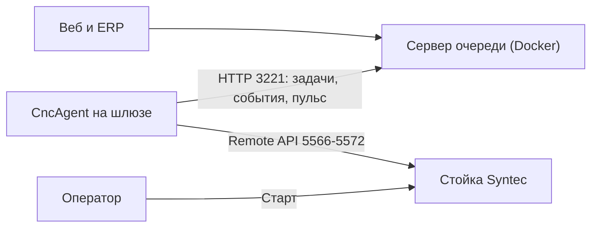

# Внедрение на станке: пошагово

Станок: Velber M2130ATC-R12, стойка Syntec 60W-E (Windows CE, ПО 10.118.14H, тип WOOD). Программы — `.cnc` из UcanCAM (папки `chpu-driver/БРЕНД АРДЕКО/860`, `/960`).

Результат: технолог ставит программы в очередь в вебе, агент сам кладёт их в память стойки и делает основной, оператор только кладёт заготовку и жмёт «Старт», а веб показывает состояние станка, строку программы, тревоги и готовые детали. Флешка больше не нужна.

## Как это работает



1. Технолог загружает программы `.cnc` в вебе (по одной или папкой) и ставит задачу: программа, количество, станок.
2. Агент на шлюзе забирает задачу, скачивает файл (проверяет SHA-256) и через Remote API кладёт его в память стойки. Задача — «доставлена».
3. Когда стойка в покое, агент делает программу основной. Задача — «загружена».
4. Оператор ставит заготовку, проверяет инструмент и ноль и нажимает «Старт». Агент видит START — задача «в работе», видны строка программы, подача, обороты, тревоги.
5. После M30 счётчик деталей стойки растёт — агент засчитывает деталь. Когда сделано всё количество — «выполнена», агент выбирает следующую задачу.

На стойку ничего не устанавливается. Агент не нажимает «Старт», не перезаписывает программу, которая сейчас выполняется, и не меняет основную программу во время работы. Если оператор сам выбрал другую программу, агент это уважает и больше её не переключает.

## Что нужно

- Коммутатор на 5–8 портов и патч-корды: стойка, шлюз, сервер.
- Шлюз — любой компьютер с Windows 7 SP1 / 10 / 11 и .NET Framework 4.8 (в Windows 10 22H2 и 11 он уже есть). Можно сам сервер, если стойка в той же сети.
- Сервер — компьютер с Docker Desktop и Node.js 20+ (можно тот же, что для лазера: порты не пересекаются).
- Флешка с папкой `agent\usb\CncAgent`.
- Человек, который знает пароль уровня обслуживания стойки (нужен для меню «Сеть»), и оператор станка.

## Шаг 0. Подготовка на компьютере с интернетом (один раз)

Сеть станков без интернета, поэтому всё скачивается заранее.

1. Node.js 20+, Docker Desktop, .NET SDK (или готовый `laser-erp\agent\.tools\dotnet`).
2. Архив симулятора Syntec 10.118 `CNC520.zip` (CNC Monitor v10.118.520) — из него берётся клиент Remote API 10.118. Сейчас лежит в `D:\VMs\cnc-stand\dl\CNC520.zip`.
3. В папке `cnc-erp\agent`:

   ```powershell
   .\build-usb.ps1 -SimulatorZip D:\VMs\cnc-stand\dl\CNC520.zip
   ```

   Скрипт скачивает DLL Syntec v4 и Visual C++ 2005 SP1 x86, достаёт из архива DLL 10.118, сверяет SHA-256 всех файлов, собирает агента и кладёт всё в `agent\usb\CncAgent`. Эту папку скопировать на флешку.
4. Если на шлюзе может не оказаться .NET 4.8, положить на флешку в `redist` автономный `ndp48-x86-x64-allos-enu.exe`.
5. На будущем сервере один раз запустить `Запустить-сервер.cmd` при включённом интернете: Docker скачает образы Convex и Node, `npm` — зависимости. Дальше сервер стартует без интернета.

## Шаг 1. Обследование станка (15 минут, без резки)

До установки посмотреть на стойке и записать (лучше сфотографировать экраны):

| Что | Где | Зачем |
|---|---|---|
| Версия ПО | «Обслуживание → Информация» | должна быть 10.118.x |
| Есть ли Core server / Remote | «Обслуживание → Сеть» | без него только доставка файлов, без состояния |
| Сетевые настройки | «Обслуживание → Сеть» | адрес стойки |
| Resource Shared / Shared Folder Path / FTP | «Обслуживание → Сеть» | запасная доставка |
| Счётчик деталей по M30 | параметры Part Count | по нему агент засчитывает детали |
| Как называются программы в памяти | менеджер файлов | только латиница, цифры, `_`, `-` |

## Шаг 2. Сеть станков без интернета

В сети станков нет шлюза в интернет и DNS, поэтому ни стойка, ни шлюз ничего не скачивают и не обновляются.

| Узел | Адрес | Маска | Шлюз |
|---|---|---|---|
| Сервер очереди | 192.168.50.1 | 255.255.255.0 | пусто |
| Шлюзы (агенты) | 192.168.50.2–.19 | 255.255.255.0 | пусто |
| Стойки ЧПУ | 192.168.50.20 и дальше | 255.255.255.0 | пусто |

Если у сервера два сетевых адаптера (офис и станки), шлюз по умолчанию остаётся только на офисном, а на адаптере станков его нет. Мост между адаптерами и общий доступ к интернету (ICS) не включать. Адрес шлюзу задаёт `Настроить-сеть.cmd` с флешки или установщик агента.

## Шаг 3. Сервер

На сервере в папке `cnc-erp`:

```bat
set SERVER_IP=192.168.50.1
Запустить-сервер.cmd
```

`SERVER_IP` — адрес сервера в сети станков; без него скрипт возьмёт адрес адаптера со шлюзом по умолчанию. Скрипт поднимает Convex, панель и веб, загружает функции, задаёт ключи и открывает порты 3220, 3221, 5174, 6792 в брандмауэре. При первом запуске он создаёт `server\.env` с ключами `cnc-stand-dev` — для цеха заменить `AGENT_TOKEN` и `API_TOKEN` в `server\.env` на свои и запустить скрипт ещё раз.

В конце скрипт печатает адрес веба (`http://192.168.50.1:5174`), `BaseUrl` агента (`http://192.168.50.1:3221`) и ключи — записать для установки агента.

Проверка: веб открывается с другого компьютера сети, вкладка «Программы» принимает файл из `АРДЕКО/860`, видны превью, инструменты и время.

## Шаг 4. Стойка

Один раз, на остановленном станке:

На этой стойке (экран английский, WOOD) сети нет в пункте «Сеть». Она здесь:

1. Кабель в Ethernet стойки.
2. F5 Maintain → F2 Set Kernel Server. Страница IP Address Parameter. Оставить «Specify an IP Address». IP `192.168.50.20`, маска `255.255.255.0`, Default Gateway и Primary DNS стереть. PC Name, Dir Name и Shared Folder Path не трогать. Save Setting.
3. На этой же странице F5 Set Kernel Server: Start server while boot = Yes, F1 Start Server. Стойка слушает порты 5566–5572.
4. Счётчик деталей уже считает по M30 (параметр 3804). Его не менять и Total Acum Par не обнулять.
5. Выключить и включить стойку. Сервер связи должен подняться сам.

Не открывать Wifi Module Setting, Syntec EagleEye и F3 CloudAgent. Красную надпись про SB Restore Files не выполнять.

## Шаг 5. Шлюз

1. Подключить шлюз кабелем к коммутатору.
2. Вставить флешку, запустить `Установить.cmd`, согласиться на права администратора.
3. Ответить на вопросы: адрес сервера (192.168.50.1), адрес стойки (192.168.50.20), ключ агента, имя станка латиницей (`velber-1`).

Установщик ставит Visual C++ 2005 SP1 x86 (нужен библиотекам Syntec), задаёт шлюзу адрес в сети станков, проверяет ping и порт 5566, показывает ответ стойки (`--check`) и регистрирует задачу планировщика `CncAgent` от имени SYSTEM: агент стартует при включении компьютера, вход в Windows не нужен, после сбоя перезапускается через минуту.

Агент и журнал: `C:\Program Files (x86)\CncAgent\` (`cnc-agent.json`, `cnc-agent.log`). Повторный запуск `Установить.cmd` обновляет агента и сохраняет настройки.

## Шаг 6. Проверка без резки

1. `Проверить-стойку.cmd` — должно быть «Связь есть: Syntec … ПО 10.118…, библиотека syntec-10.118», режим, состояние, основная программа, счётчик, память.
2. `Проверить-передачу.cmd` — передаёт `ERP-TEST.CNC` (комментарий и `M30`, без движений) тем же путём, что и агент. Ожидаем «ПЕРЕДАН через Remote API. В списке программ стойки: есть». Основную программу он не меняет.
3. Если передача падает с «стойка не приняла файл» — включить запасную доставку (ниже) и повторить.
4. Веб → «Станки»: `velber-1` онлайн, «связь есть», ПО стойки, файлы на стойке.

## Шаг 7. Приёмочный прогон

Делать в присутствии оператора, сначала без заготовки или с поднятым Z.

| Шаг | Действие | Ожидаем |
|---|---|---|
| 1 | Веб → «Станки» | `velber-1` онлайн, «связь есть», режим, состояние READY, ПО стойки |
| 2 | Загрузить короткую программу, поставить задачу на 1 деталь | через 2–10 с задача «доставлена», файл в списке «Файлы на стойке» |
| 3 | — | стойка в AUTO и покое: программа стала основной, задача «загружена» |
| 4 | Оператор: «Старт» | «в работе», растёт номер строки, видны подача и обороты |
| 5 | Оператор: «Стоп/Сброс» посередине | задача снова «загружена», деталь не засчитана |
| 6 | «Старт» и дождаться M30 | деталь засчитана, задача «выполнена» |
| 7 | Вызвать тревогу (например, открыть дверь, если она в блокировке) | тревога видна в карточке станка и в журнале |
| 8 | Выдернуть кабель на минуту и вернуть | «нет связи со стойкой», потом «связь восстановлена», события не потерялись |
| 9 | Оператор вручную выбрал другую программу | задача «доставлена», агент её больше сам не выбирает |

Шаги 1–3, 7 и 9 уже пройдены на симуляторе Syntec 10.118 в виртуалке, шаги 4–6 и 8 — только на станке (см. `HANDOFF.md`, «Что проверено»). Если в шаге 6 счётчик стойки не растёт, агент всё равно засчитает деталь, когда программа дошла до последних строк; поправить вручную можно на странице задачи (±1).

## Запасная доставка через общую папку стойки

Если Remote API читает состояние, но не принимает файлы:

1. На стойке: «Обслуживание → Сеть», раздел «Resource Shared» / «Shared Folder Path»: открыть в сеть папку `NcFiles` (общая папка или FTP).
2. В `cnc-agent.json` оставить `"Link": "syntec"` и добавить `"RemoteDir": "\\\\192.168.50.20\\NcFiles"` или `"RemoteDir": "ftp://192.168.50.20/NcFiles"` с `"FtpUser"` и `"FtpPassword"`.
3. Перезапустить задачу `CncAgent` и повторить `Проверить-передачу.cmd`: должно быть «через папка …» и «В списке программ стойки: есть».

Состояние и выбор основной программы остаются на Remote API. Файл, который Remote API не установил, агент пишет в папку и до перезапуска шлёт туда все следующие. Windows CE отдаёт папку по SMB1: если шлюз её не открывает, включить на шлюзе «Компоненты Windows → Поддержка общего доступа к файлам SMB 1.0 → Клиент» (сеть без интернета, это допустимо) или взять FTP.

Если файлы не идут через API, а `"SyntecLib"` в `cnc-agent.json` стоит `"v4"`, вернуть `"auto"`: старая библиотека v4 не передаёт файлы на ПО 10.118.

## Если Remote API нет

Агент умеет только класть файлы, без состояния станка:

- в сетевую папку стойки: `"Link": "folder"`, `"RemoteDir": "\\\\192.168.50.20\\NcFiles"`;
- на FTP стойки: `"Link": "ftp"`, `"RemoteDir": "ftp://192.168.50.20/NcFiles"`, `"FtpUser"`, `"FtpPassword"`.

Правка в `cnc-agent.json`, затем перезапуск задачи `CncAgent`. Задача доходит до «доставлена», программу оператор выбирает на стойке сам, детали отмечаются в вебе (±1 на странице задачи) или через `POST /api/jobs/parts`.

## Шаг 8. Ввод в работу

- Технолог: загружает папки программ в «Программы», ставит задачи на «Очереди». Повторная загрузка того же файла не создаёт дубликат, новая версия с тем же именем становится текущей.
- Оператор: на стойке видит основную программу из очереди, проверяет инструмент и ноль, жмёт «Старт». Если нужно резать другое — выбирает программу на стойке сам, агент не мешает. Испорченную деталь технолог снимает кнопкой −1 на странице задачи.
- Первую неделю раз в день сверять «выполнено» в вебе с фактом и смотреть журнал станка.

## Обслуживание

| Что | Как |
|---|---|
| Журнал агента | `C:\Program Files (x86)\CncAgent\cnc-agent.log` (ротация по 5 МБ), последние 30 строк видны в карточке станка в вебе |
| Перезапуск агента | Планировщик заданий → `CncAgent` → завершить и выполнить, или перезагрузить шлюз |
| Обновление агента | новая флешка из `build-usb.ps1` → `Установить.cmd` (настройки сохраняются) |
| Обновление сервера | новая папка `cnc-erp` → `Запустить-сервер.cmd` (данные в томе Docker `cnc-erp_convex-data` сохраняются) |
| Резервная копия | в папке `cnc-erp`: `set CONVEX_SELF_HOSTED_URL=http://127.0.0.1:3220`, `set CONVEX_SELF_HOSTED_ADMIN_KEY=<ключ>`, `npx convex export --include-file-storage --path backup.zip` (файлы программ лежат в хранилище, без флага их в копии не будет). Ключ даёт та же команда `docker run … generate_admin_key.sh`, что в `Запустить-сервер.cmd` |
| Остановка сервера | `docker compose -f server\docker-compose.yml down` |

## Неисправности

| Сообщение | Причина и что делать |
|---|---|
| «нет связи с Remote API: стойка … не отвечает» | не включён Core server, неверный адрес стойки, кабель. `Проверить-стойку.cmd` |
| «не загружается библиотека Syntec (нужен Microsoft Visual C++ 2005 SP1 x86)» | запустить `redist\vcredist2005_x86.exe` |
| «стойка не приняла файл (код SocketError (-16))» | старая библиотека v4 на ПО 10.118: `"SyntecLib": "auto"`, проверить, что в папке агента есть `syntec-10.118` |
| «стойка не приняла файл (код …)» с другим кодом | программа с этим именем выполняется, мало памяти, запрет записи. Освободить память, «Повторить» в вебе; если на любом файле — запасная доставка |
| «файл передан, но в списке программ стойки его нет» | стойка положила файл не в `NcFiles`; запасная доставка |
| «стойка не дала выбрать … (режим …)» | стойка не в AUTO или занята; агент повторит сам через 15 с |
| «сервер недоступен» | кабель или адрес сервера; события агент хранит в `outbox.json` и дошлёт сам |
| Станок «офлайн» в вебе | агент не шлёт пульс 30 с: шлюз выключен, задача `CncAgent` остановлена, сеть |

## Откат

`Удалить.cmd` на шлюзе убирает агента, задачу и правила брандмауэра. Программы в памяти стойки остаются, работа с флешкой возвращается как была. На стойке можно выключить Core server.
